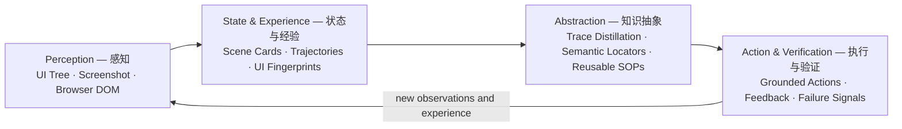

# Phone Use

**Learn how Android apps work through interaction — not just how to tap them.**

Phone Use is an Android interaction plugin for AI agents. It connects desktop AI agents to Android devices and treats phone use as a process of exploring a digital environment, accumulating interaction experience, building an understanding of how that environment works, and continually improving decisions.

Rather than treating every task as a fresh sequence of taps, Phone Use builds a **symbolic environment model** from interaction evidence. It can reuse what it has learned from earlier interactions, including where features are located, how to navigate to them, and which workflows have worked before. Its knowledge is grounded in actual device observations—not hard-coded coordinates.

The goal is to move from **Learning to Act**—learning how to operate an interface—to **Learning How the World Works**: learning how an app environment behaves so an agent can make better decisions over time.



Phone Use works through **Model Context Protocol (MCP)** and can be used with **Claude Code, MiniMax Code, Codex, and Cursor**. The Android-side service runs through ADB; no root or Shizuku is required.

**Version:** `0.8.25` · **[Documentation](docs/PHONE-USE.md)** · **[Agent skill](skills/phone-use/SKILL.md)** · **[Evaluation reports](https://github.com/Timothy-kira/phone-use/tree/audit-reports/audit)**

## Why Phone Use?

A conventional GUI agent primarily needs to answer: **“What should I click next?”**

Phone Use also preserves answers to longer-lived questions:

- **Where is a feature?** Build an app map of observed screens and navigation edges.
- **How do I return to it?** Find a known route, resolve controls against the live UI, and verify each transition.
- **What did this attempt establish?** Associate screen observations, actions, receipts, and task checks with referenceable evidence.
- **What can be reused?** Distill successful interactions or human demonstrations into methods and verified GUI flows rather than coordinate tapes.
- **What failed?** Retain failure signals and feed execution results back into workflow validation and maturity.

Phone Use builds **interaction-grounded knowledge of the digital environment**. This refers to learned information about observed app behavior—not a claim of a general-purpose predictive world model.

## Capabilities

| Capability | Description |
| --- | --- |
| **Learn from interaction** | Retain useful knowledge from actual Android tasks and user demonstrations, rather than replaying fixed tap coordinates. |
| **Explore and navigate** | Discover app features, remember navigation paths, and revisit known destinations. |
| **Reusable workflows** | Capture, recall, and validate GUI procedures for recurring tasks. |
| **Evidence-backed execution** | Observe UI state, inspect action results, and verify progress toward the user's goal. |
| **Android app control** | Launch apps, inspect screens, interact with controls, scroll, and enter or edit text. |
| **Mobile browser** | Browse and interact with web pages on the phone, including forms and content extraction. |
| **Live phone window** | Watch the agent work and take over to demonstrate a task when needed. |
| **Multiple agent harnesses** | Connect to Claude Code, MiniMax Code, Codex, Cursor, and other compatible MCP hosts. |
| **Multi-task coordination** | Support multiple virtual displays with safeguards for shared app and input resources. |

Phone Use normally operates on a **virtual display**, leaving the primary phone screen available. It uses ADB and does not require root or Shizuku. Some device-specific operations may need the real screen or additional user-approved setup.

## Quick start

### Requirements

- **Python 3.9+** and **ADB** (`adb` on `PATH`, or set `PHONE_USE_ADB`).
- An Android device with **USB or wireless debugging** authorized for your computer.
- A **Chromium-based browser** for the optional live phone window.
- **Android 10+** for virtual-display support, subject to device and app compatibility.

### Install

```bash
git clone https://github.com/Timothy-kira/phone-use.git
cd phone-use
python install.py
```

The installer detects supported harnesses and asks before configuring each one. You can inspect detected hosts with:

```bash
python install.py --list
```

After connecting and authorizing your phone, invoke `phone_status` from your agent harness to check ADB, the Android-side service, and the phone window. Then use `agent_display` for Android apps or `phone_browser` for web pages on the phone.

For the full setup guide, tool arguments, optional input companion, multi-device operation, and safety behavior, see **[docs/PHONE-USE.md](docs/PHONE-USE.md)** and **[skills/phone-use/SKILL.md](skills/phone-use/SKILL.md)**.

## Evaluation results

| Benchmark | Passed / Total | Pass rate | Report & traces |
| --- | ---: | ---: | --- |
| AndroidWorld | **113 / 116** | **97.41%** | [Details](https://github.com/Timothy-kira/phone-use/tree/audit-reports/audit) |
| MiniWoB++ | **85 / 92** | **92.39%** | [Details](https://github.com/Timothy-kira/phone-use/tree/audit-reports/audit/miniwob) |

## Repository structure

| Path | Purpose |
| --- | --- |
| [`mcp/`](mcp/) | Host-side MCP tools and utilities. |
| [`server/`](server/) | Android-side service and supporting components. |
| [`skills/phone-use/`](skills/phone-use/) | Agent-facing workflows and safety instructions. |
| [`docs/PHONE-USE.md`](docs/PHONE-USE.md) | Detailed setup, tools and operating guide. |
| [`install.py`](install.py) | Harness discovery and plugin installation. |
| [`bin/`](bin/) | Android-side server APK. |
| [`audit-reports` branch](https://github.com/Timothy-kira/phone-use/tree/audit-reports) | Evaluation results and full traces. |

The default branch **`插件`** contains the installable plugin and source code. The **`audit-reports`** branch contains the evaluation archive.
